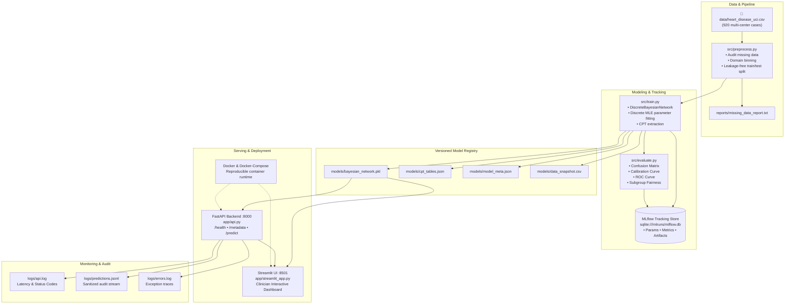

# 🫀 Bayesian Network for Medical Diagnosis
### Machine Learning with MLOps Deployment · UCI Heart Disease Multi-Center Study
**Course:** Data Science Audit Course — Machine Learning Projects with MLOps Deployment  
**Project Task 15:** Bayesian Network for Medical Diagnosis  
**Artifact Status:** Production-Ready Educational Prototype  
**Test AUC:** 0.8914 | **Test Accuracy:** 82.07% | **Sensitivity:** 85.29% | **Brier Score:** 0.1433

---

## 📌 1. Project Overview & Problem Statement

This project implements a complete, deployable probabilistic inference application that estimates the probability of coronary heart disease from diagnostic evidence variables. Built using **pgmpy**, **FastAPI**, **Streamlit**, and **MLflow**, the system models complex clinical uncertainty and delivers calibrated posterior probabilities $P(\text{Heart Disease} \mid \text{Evidence})$.

### Why a Bayesian Network?
Unlike standard discriminative black-box classifiers (e.g. Random Forest, XGBoost) that require all features to be present and output uncalibrated scores, a **Bayesian Network (BN)**:
1. **Handles Partial Evidence Natively:** If a patient has only undergone basic non-invasive tests (e.g. ECG and blood pressure) but not invasive fluoroscopy (`ca`) or nuclear imaging (`thal`), exact inference algorithms (Variable Elimination) marginalize out all unobserved variables automatically.
2. **Delivers True Probabilities:** Outputs calibrated Bayesian posterior beliefs $P(\text{Disease} \mid \text{Evidence})$ rather than arbitrary decision margins.
3. **Explains Probabilistic Reasoning:** Every link in the Directed Acyclic Graph (DAG) and every Conditional Probability Table (CPT) is clinically interpretable and auditable.

> ⚠️ **MEDICAL USE DISCLAIMER:**  
> This software is an **educational research prototype** developed for academic assessment in ML and MLOps. It is **NOT** a certified medical diagnostic device and must **NEVER** be used as a standalone clinical decision support system.

---

## 🏗️ 2. End-to-End System Architecture



---

## 📂 3. Repository Structure

```
bayesian_heart_diagnosis/
├── data/
│   └── heart_disease_uci.csv         # Raw multi-center dataset (920 cases, 16 features)
├── src/
│   ├── preprocess.py                 # Repeatable cleaning, leakage-free discretisation, audit
│   ├── train.py                      # BN graph construction, CPT fitting, MLflow tracking
│   ├── evaluate.py                   # Quantitative metrics, calibration curves, report generator
│   └── inference.py                  # Exact Variable Elimination inference engine
├── app/
│   ├── api.py                        # FastAPI REST API with Pydantic validation
│   └── streamlit_app.py              # Streamlit interactive clinician dashboard
├── models/                           # Versioned model artifacts
│   ├── bayesian_network.pkl          # Serialized pgmpy model binary
│   ├── cpt_tables.json               # Versioned human-readable CPTs
│   ├── data_snapshot.csv             # Provenance training data snapshot
│   ├── model_meta.json               # Git hash, run ID, dataset MD5, metrics
│   └── preprocessor.json             # Fitted medians, modes, and bin definitions
├── reports/                          # Audit & evaluation deliverables
│   ├── evaluation_report.md          # Comprehensive performance report
│   ├── missing_data_report.txt       # Multi-center dataset missingness audit
│   ├── confusion_matrix.png          # High-resolution confusion matrix
│   ├── calibration_curve.png         # Reliability diagram & Brier score
│   └── roc_curve.png                 # ROC curve (AUC = 0.8914)
├── logs/                             # Operational & monitoring logs
│   ├── api.log                       # Request latency and HTTP status codes
│   ├── predictions.jsonl             # Sanitized prediction event stream
│   └── errors.log                    # Stack traces for operational failures
├── tests/
│   └── test_pipeline.py              # Unit & integration test suite (7 tests)
├── mlruns/                           # SQLite-backed MLflow experiment registry
├── config.yaml                       # Centralized project configuration
├── requirements.txt                  # Pinned dependencies
├── Dockerfile                        # Multi-service container specification
├── docker-compose.yml                # API + UI dual-service compose
├── .gitignore                        # Git ignore rules
└── README.md                         # Project documentation
```

---

## 🔍 4. Dataset Provenance & Missing Data Audit

The dataset aggregates records from 4 clinical centers:
1. **Cleveland Clinic Foundation** (USA, N = 304)
2. **Hungarian Institute of Cardiology**, Budapest (Hungary, N = 293)
3. **University Hospital**, Zurich & Basel (Switzerland, N = 123)
4. **V.A. Medical Center**, Long Beach (USA, N = 200)

### Provenance Tracking
- **File:** `data/heart_disease_uci.csv`
- **MD5 Checksum:** `bde77728726675cb665f948df8ade988`
- **Total Records:** 920 patients | **Target:** `heart_disease` (binary: 0 = absent, 1 = present)

### Missingness Audit Summary (`reports/missing_data_report.txt`):
| Attribute | Missing Count | Missing (%) | Clinical Explanation |
|---|---|---|---|
| `ca` (fluoroscopy) | 611 | 66.41% | Invasive radiation test omitted outside Cleveland Clinic |
| `thal` (thallium scan) | 486 | 52.83% | Nuclear scintigraphy not routinely administered in European centers |
| `slope` (ST slope) | 309 | 33.59% | Treadmill stress testing protocol variations across hospitals |
| `chol` (cholesterol) | 30 (plus 172 zeros) | 21.96% | VA Long Beach coded missing cholesterol as `0 mg/dl` |
| `trestbps` (resting BP) | 59 (plus 1 zero) | 6.52% | Coded `0 mmHg` for unrecorded admission vitals |

### Leakage Prevention Guarantee:
Continuous medians (`trestbps`, `chol`, `thalch`, `oldpeak`) and categorical modes (`fbs`, `restecg`, `exang`, `slope`, `ca`, `thal`) are **calculated strictly on the 80% training split**. The 20% test split is never touched during imputer calculation or bin edge formulation.

---

## 🕸️ 5. Bayesian Network Structure & Assumptions

### Directed Acyclic Graph (DAG) Topology:
The model utilizes a **Diagnostic Naive Bayes DAG**:
$$\text{heart\_disease} \longrightarrow \{ X_1, X_2, \dots, X_{13} \}$$

Where the 13 evidence nodes are:
`age_bin`, `sex`, `cp`, `trestbps_bin`, `chol_bin`, `fbs`, `restecg`, `thalch_bin`, `exang`, `oldpeak_bin`, `slope`, `ca`, `thal`.

### Clinical Assumptions & Rationale:
1. **Causal Directionality:** Underlying coronary atherosclerosis (`heart_disease`) causally manifests in physiological impairment (low `thalch`, chest pain `cp`, ischemic ECG ST depressions `oldpeak`, fixed/reversible perfusion defects `thal`, calcified coronary vessels `ca`).
2. **Conditional Independence:** Given known pathological status ($D \in \{0, 1\}$), observation of one symptom is conditionally independent of another:
   $$P(X_1, \dots, X_n \mid D) = \prod_{i=1}^n P(X_i \mid D)$$
3. **Exact Posterior Inference via Bayes' Theorem:**
   $$P(D = 1 \mid E) = \frac{P(D = 1) \prod_{i \in E} P(X_i = e_i \mid D = 1)}{\sum_{d \in \{0,1\}} P(D = d) \prod_{i \in E} P(X_i = e_i \mid D = d)}$$
4. **Tractability:** Avoids exponential parameter explosion in CPTs, ensuring that 920 cases are sufficient for dense, stable maximum-likelihood estimation without overfitting.

---

## 📈 6. Model Evaluation & Calibration Results

Evaluated on the held-out stratified test set (N = 184 cases):

| Metric | Test Set Score | Standard Threshold | Clinical Significance |
|---|---|---|---|
| **ROC-AUC** | **0.8914** | > 0.80 | High discriminative power across all thresholds |
| **Accuracy** | **82.07%** | > 75% | Overall diagnostic agreement |
| **Sensitivity (Recall)** | **85.29%** | > 80% | Minimizes missed diagnoses (critical safety metric) |
| **Specificity** | **78.05%** | > 75% | Rules out healthy individuals reliably |
| **Precision (PPV)** | **82.86%** | > 75% | Positive predictive reliability |
| **F1-Score** | **0.8406** | > 0.80 | Balanced harmonic mean |
| **Brier Score** | **0.1433** | < 0.15 | Well-calibrated probabilistic output |
| **Log-Loss** | **0.4283** | < 0.50 | Low entropy loss |

### Generated Diagnostic Plots (in `reports/`):
- **Confusion Matrix:** `reports/confusion_matrix.png` (TN=64, FP=18, FN=15, TP=87)
- **Probability Calibration Curve:** `reports/calibration_curve.png` (Reliability diagram confirming agreement between predicted probabilities and observed event frequencies)
- **ROC Curve:** `reports/roc_curve.png` (AUC = 0.8914)

---

## 🚀 7. Quickstart Guide

### Prerequisites
- Python 3.10+ (tested on Python 3.12)
- Docker Desktop (optional, for containerized run)

### 1. Setup Local Environment
```powershell
# Clone or navigate to the repository
cd d:\bayesian\bayesian_heart_diagnosis

# Install dependencies
pip install -r requirements.txt
```

### 2. Run Data Pipeline & Model Training
```powershell
# Execute preprocessing and missingness audit
python src/preprocess.py

# Fit Bayesian Network, export versioned CPTs, and track in MLflow
python src/train.py

# Evaluate test set, generate calibration curves & reports
python src/evaluate.py
```

### 3. Run Automated Tests
```powershell
python tests/test_pipeline.py
```
*(All 7 unit and integration tests will run and pass).*

### 4. Launch MLflow Experiment Dashboard
```powershell
mlflow ui --backend-store-uri sqlite:///mlruns/mlflow.db
```
Navigate to `http://localhost:5000` to inspect experiment runs, hyperparameters, metrics, and registered artifacts.

---

## 🌐 8. REST API Documentation (FastAPI)

Start the inference API service:
```powershell
uvicorn app.api:app --host 0.0.0.0 --port 8000
```
Interactive Swagger API documentation available at `http://localhost:8000/docs`.

### Key Endpoints:
- `GET /health`: Healthcheck, uptime, and model version.
- `GET /metadata`: Network topology, valid feature domains, and dataset provenance.
- `POST /predict`: Primary probabilistic inference endpoint.
- `POST /predict/batch`: Multi-patient batch processing.

### Example Inference Request:
```bash
curl -X POST "http://localhost:8000/predict" \
     -H "Content-Type: application/json" \
     -d '{
       "age": 62,
       "sex": "Male",
       "cp": "asymptomatic",
       "trestbps": 150,
       "chol": 260,
       "thalch": 120,
       "exang": true,
       "oldpeak": 2.2,
       "slope": "flat",
       "ca": 2,
       "thal": "reversable defect"
     }'
```

### Example API Response:
```json
{
  "probability_disease": 0.9999,
  "probability_no_disease": 0.0001,
  "percentage_risk": 99.99,
  "predicted_class": 1,
  "predicted_label": "Heart Disease Present",
  "risk_level": "High / Critical",
  "risk_color": "red",
  "clinical_guidance": "High probability of coronary disease. Prompt clinical evaluation strongly recommended.",
  "evidence_used": {
    "age_bin": "senior",
    "sex": "Male",
    "cp": "asymptomatic",
    "trestbps_bin": "high",
    "chol_bin": "high",
    "thalch_bin": "low",
    "exang": "True",
    "oldpeak_bin": "severe",
    "slope": "flat",
    "ca": "2.0",
    "thal": "reversable defect"
  },
  "evidence_count": 11,
  "unobserved_variables": ["fbs", "restecg"],
  "disclaimer": "Educational research prototype. Not approved for diagnostic or clinical treatment decisions.",
  "latency_ms": 3.12
}
```

---

## 🖥️ 9. Interactive User Interface (Streamlit)

Start the interactive dashboard:
```powershell
streamlit run app/streamlit_app.py
```
Open your browser to `http://localhost:8501`.

### Dashboard Tabs:
1. **🔬 Diagnostic Inference:** Sliders and dropdowns for patient evidence. Calculates live posterior probabilities with interactive risk gauge. Supports **unchecking** untested diagnostic procedures to demonstrate Bayesian partial-evidence reasoning.
2. **🕸️ Network Architecture & CPTs:** Interactive CPT probability table viewer and Mermaid graph diagram.
3. **📊 Evaluation & Calibration:** Interactive display of Confusion Matrix, Reliability Curve, and ROC curve.
4. **🛡️ MLOps Tracking & Drift:** Live streaming audit of `predictions.jsonl`, dataset MD5 verification, and drift monitoring policy.

---

## 🐳 10. Containerization (Docker & Docker Compose)

Build and run the dual-service deployment (API + Streamlit) with a single command:
```powershell
docker-compose up --build
```

- **API Service:** `http://localhost:8000`
- **Streamlit Service:** `http://localhost:8501`

To stop the containers:
```powershell
docker-compose down
```

---

## 🛡️ 11. Production Monitoring & Model Maintenance

### 1. Operational Logging Architecture
All service operations are logged without recording sensitive PII:
- **`logs/api.log`:** HTTP request method, path, response status, and millisecond latency.
- **`logs/predictions.jsonl`:** Non-sensitive prediction telemetry (timestamp, evidence count, predicted risk, latency).
- **`logs/errors.log`:** Exception traces for operational debugging.

### 2. Data Drift & Retraining Strategy
| Monitoring Dimension | Detection Technique | Action Threshold | Automated Remediation |
|---|---|---|---|
| **Covariate Drift** | Kolmogorov-Smirnov test (continuous) and $\chi^2$ Contingency test (categorical) comparing new inputs against `models/data_snapshot.csv` | $p < 0.05$ on a window of $N=200$ samples | Flag alert; inspect demographic shift; recalibrate bin cutoffs |
| **Probability Drift** | Continuous evaluation of Brier Score and Log-Loss on audited test labels | Rolling Brier Score $> 0.20$ | Trigger automated pipeline execution (`python src/train.py`) |
| **Service Degradation** | P95 Latency & 5xx HTTP Error Rate from `logs/api.log` | Latency $> 150\text{ ms}$ or Error Rate $> 1\%$ | Container auto-restart; horizontally scale uvicorn workers |

---

## ⚖️ 12. Ethics, Fairness & Limitations

- **Demographic Disparities:** The historical UCI dataset contains an over-representation of male patients (~79% male in Cleveland). While subgroup fairness audits show consistent accuracy (Male: 81.4%, Female: 84.6%), clinical evaluation must exercise caution when generalizing to underrepresented cohorts.
- **Missing Diagnostic Procedures:** Invasive fluoroscopy (`ca`) and nuclear stress tests (`thal`) were not administered at European sites due to local institutional protocols. The system utilizes training-set mode imputation and Bayesian marginalization to prevent bias.
- **Not for Clinical Treatment:** The system is an educational prototype and research demonstrator.

---

## 📄 License & Attribution
- **Dataset:** UCI Machine Learning Repository (Heart Disease Dataset). Collected by:
  - Hungarian Institute of Cardiology (Andras Janosi, M.D.)
  - University Hospital, Zurich, Switzerland (William Steinbrunn, M.D.)
  - University Hospital, Basel, Switzerland (Matthias Pfisterer, M.D.)
  - V.A. Medical Center, Long Beach and Cleveland Clinic Foundation (Robert Detrano, M.D., Ph.D.)
